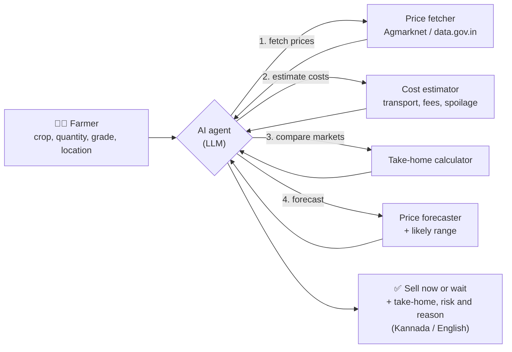
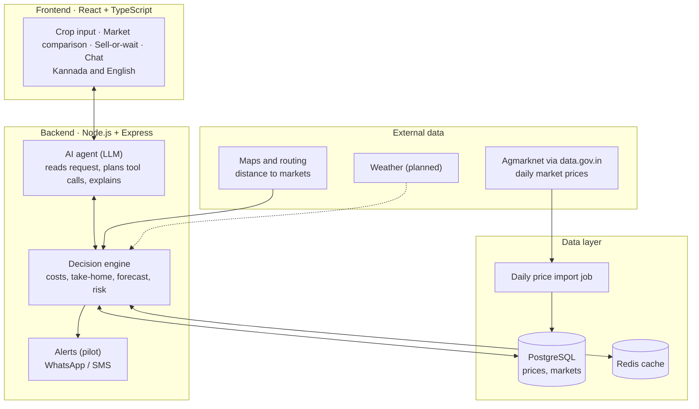

<p align="center">
  
</p>

<h1 align="center">AgroSathi – AI Crop-Selling Advisor</h1>

<p align="center">
  <b>Helping farmers decide where to sell and when, so they take home more from every harvest.</b><br/>
  GAVS Hackathon · Theme: Agriculture and Food Processing · Problem statement 6.1
</p>

---

## The problem

Many small farmers sell their harvest at the nearest market on the day they harvest. They usually can't easily tell whether another market nearby, or waiting a few days, would earn them more.

- **Prices differ by market.** Nearby markets can pay very different prices for the same crop on the same day.
- **Prices change fast.** Perishable crops like tomato can't wait long, and prices can swing within days.
- **A higher price can earn less.** Transport and market fees can cancel out a better price.

## Our solution

AgroSathi is a mobile-first AI selling assistant. The farmer enters the crop, quantity, grade and location. AgroSathi then gives **one clear recommendation**, such as *"Sell at Market B today"* or *"Wait 3 days"*, together with:

- the money the farmer will **actually take home**
- how much more that is than the alternative
- a **risk level** and a likely price range
- a short reason in simple **Kannada or English**

### The key idea: take-home money, not headline price

```
Take-home = (Price × Quantity) − Transport − Market fees − Spoilage/storage cost
```

| 20 quintals of tomato *(illustrative figures)* | Market A (far) | Market B (near) |
|---|---:|---:|
| Price per quintal | ₹2,350 | ₹2,280 |
| Sale value | ₹47,000 | ₹45,600 |
| Transport | − ₹3,000 | − ₹800 |
| Market fees (2%) | − ₹940 | − ₹912 |
| **Take-home** | **₹43,060** | **₹43,888 ✅** |

Market B shows a lower price but leaves the farmer **₹828 more**. AgroSathi is built to surface exactly this kind of decision.

## How the AI agent works

AgroSathi uses an **agentic AI** design. An LLM-based agent plans the steps and explains the result, while every number comes from tools that use official data and fixed formulas. The AI never makes up a price.



1. **Understand** the crop, quantity, grade and location
2. **Fetch** the latest official prices for nearby markets
3. **Estimate** transport, market fees and spoilage or storage loss
4. **Calculate** the take-home money for each market
5. **Forecast** prices for the next few days, with a likely range
6. **Decide and explain** in simple words, then keep watching prices for a better chance

## System architecture



## Data source (already verified)

We checked the official dataset before building on it:

- **Source:** [Variety-wise Daily Market Prices Data of Commodity](https://www.data.gov.in/resource/variety-wise-daily-market-prices-data-commodity) on data.gov.in (Agmarknet), under the Government Open Data License – India
- **Detail:** market-level daily minimum, maximum and modal prices, with variety and grade
- **Coverage:** tomato and onion across Karnataka districts, including Kolar, Chikkaballapur, Mysuru, Bengaluru, Dharwad and Mandya
- **History:** 37,440 tomato price records for Kolar district alone, including records from 2017
- **Freshness:** updated daily (the latest record we checked was dated 4 November 2026)

## Project status

AgroSathi builds on our earlier AgroSathi web prototype, which we are now refocusing on crop selling for this hackathon.

| Part | Status |
|---|---|
| Web app UI (React + TypeScript, Kannada/English switch, mobile-friendly pages) | ✅ Done |
| Market price page layout (input form, results, market comparison) | ✅ Done, showing sample figures |
| Official price data source verified (coverage and freshness) | ✅ Done |
| Backend service structure (Express gateway, services, shared packages, Prisma) | ✅ Scaffolding in place |
| Daily price import from data.gov.in | 🔄 In progress |
| Take-home calculator and market ranking | 🔄 In progress |
| Price forecast and sell-or-wait recommendation | 🔄 In progress |
| AI agent chat with explanations | 🔄 In progress |
| WhatsApp/SMS alerts and voice input | ⏭️ Planned for pilot |

> The market page currently shows **sample figures** and says so on screen. We don't publish accuracy numbers until we have measured them.

## How we will measure impact

We will replay past seasons using official prices and compare AgroSathi's advice with the usual habit of selling at the nearest market on harvest day. We will report:

- extra ₹ earned per quintal
- forecast error
- how often AgroSathi's choice beats the usual habit

## Getting started

**Requirements:** Node.js 22 (or 20.19+) and npm.

```bash
git clone https://github.com/ALN-web/Agrosathi_hack.git
cd Agrosathi_hack
npm install
npm run dev
```

Then open http://localhost:3000 and go to **Services → Market Price** or `/market`.

Other commands:

```bash
npm run build     # type-check and production build
npm run lint      # lint with oxlint
npm run preview   # preview the production build
```

**Backend (in progress):** see [`backend/`](backend) and [`backend/docs/ARCHITECTURE.md`](backend/docs/ARCHITECTURE.md). Copy `backend/.env.example` to `backend/.env` and add your own data.gov.in API key as `DATA_GOV_API_KEY`. Never commit `.env` files.

## Repository structure

```
├── src/                     # React + TypeScript frontend
│   ├── pages/               # Route pages (MarketPricePage = selling module)
│   ├── components/          # UI components (Market* = selling module)
│   ├── locales/             # English (en) and Kannada (kn) translations
│   └── layouts/, lib/       # Shared layout and helpers
├── public/images/           # App images and logo
└── backend/
    ├── apps/                # Express services (gateway, market-service, …)
    ├── packages/            # Shared config, types and utilities
    ├── database/            # Prisma schema (PostgreSQL)
    ├── ai/                  # Python FastAPI service scaffolds
    ├── docker-compose.yml   # Local infrastructure
    └── docs/                # Architecture notes
```

## Roadmap

| Phase | Focus |
|---|---|
| **1 · Hackathon prototype** | Take-home market comparison, sell-or-wait forecast and AI chat in Kannada and English, for tomato and onion in Karnataka |
| **2 · Field pilot** | WhatsApp/SMS price alerts, voice input, a pilot with farmers in Kolar, and published measured results |
| **3 · Scale** | More crops and states, weather and arrival data in forecasts, and tools for farmer groups (FPOs) |

## Business model

AgroSathi is **free for farmers**. Revenue comes from partners who benefit: subscription dashboards for farmer groups (FPOs), transport partner commissions, verified buyer connections, and licences for government and extension programmes.

## Team

- **Anjankumar LN**
- **Deekshith K**
- **Gagandeep G**

---

*Market price data: Agmarknet, Directorate of Marketing and Inspection, Government of India, via [data.gov.in](https://www.data.gov.in), used under the Government Open Data License – India.*
